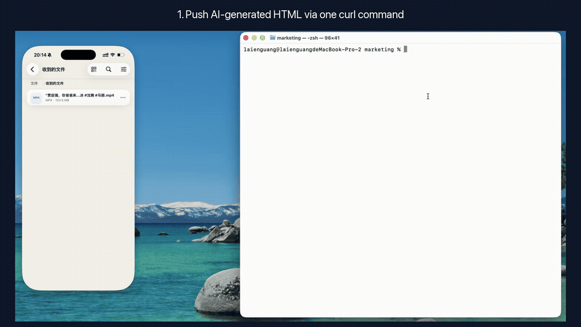

# stolnk-skill — Push AI Output Straight to Your iPhone

> Give Claude Code, Cursor, Codex, Antigravity, or any terminal agent the ability to send **HTML reports, interactive pages, Markdown docs, or any file** directly to your iPhone via [Stolnk](https://stolnk.com).



```bash
curl --fail-with-body -F "file=@report.html" https://yourname.stolnk.com
```

No environment variables, no API keys, no messaging apps, no zip files, no AirDrop range limits, no cables.
HTML renders natively as a web page on your iPhone; Markdown renders formatted—even if your phone was offline when the agent finished.

---

## Why?

When your AI agent generates a rich HTML dashboard, research report, or Markdown summary on your computer, reading it on your phone usually means emailing it to yourself, dropping it in Slack/WeChat (where HTML opens as raw source code), or wrestling with cloud drives.

With **Stolnk** + `stolnk-push`:
1. Your iPhone gets a permanent inbox address: `yourname.stolnk.com` ([Download on the App Store](https://apps.apple.com/app/id6798472788)).
2. Tell your AI agent: *"Generate an HTML summary of today's PRs and send it to `yourname.stolnk.com`."*
3. Open Stolnk on your iPhone → read the rendered page directly in **Received**.

---

## Install (Zero Config)

No environment variables or accounts to configure—the skill teaches your AI the exact upload protocol, and you simply mention your `yourname.stolnk.com` address (or let the AI ask once).

### Claude Code / Antigravity / Agent Skills Standard

Copy this folder into your skills directory:

```bash
# Personal (available in all projects)
git clone https://github.com/landar26/stolnk-skill.git ~/.claude/skills/stolnk-push

# Or project-local
git clone https://github.com/landar26/stolnk-skill.git .claude/skills/stolnk-push
```

### Cursor

Copy `SKILL.md` into `.cursor/rules/stolnk-push.mdc` (or reference it in your Cursor rules).

> **Tip**: If you don't want to type your address every time, add a single line like `My Stolnk inbox is yourname.stolnk.com` to your `CLAUDE.md`, Cursor Rules, or agent memory.

### Standalone CLI (optional)

```bash
chmod +x scripts/stolnk-push.sh
./scripts/stolnk-push.sh ./report.html yourname.stolnk.com
```

---

## Example Prompts

- *"Turn this analysis into a clean mobile-friendly HTML report and send it to `ryan.stolnk.com`."*
- *"Summarize the git diff into Markdown and push it to my iPhone."*
- *"Export this chart as a standalone HTML file and send it to my Stolnk inbox."*

---

## Limits & Privacy

- **Limit**: One file per request, up to **95 MiB** via `curl`. (For files up to 20 GB, drop them on `https://yourname.stolnk.com` in any browser.)
- **Privacy (honestly described)**: Browser uploads are end-to-end encrypted in your browser before leaving your device. Terminal (`curl`) uploads arrive over HTTPS at Stolnk's edge worker and are immediately encrypted with your iPhone's Secure Enclave public key before storage—so plaintext exists in edge memory for the duration of that single request. Don't use `curl` for raw secrets; use the browser send page for full client-side E2E encryption.

---

## 中文说明

让 Claude Code、Cursor、Codex、Antigravity 或任何命令行 AI Agent，直接把生成的 **HTML 报告、交互页面、Markdown 文档或任意文件**一键推送到你的 iPhone。

### 为什么好用？
- **零配置**：不需要设环境变量、不需要 API Key、不需要装 SDK，底层只依赖系统自带的 `curl`。
- AI 写好的 HTML 报告发到微信/邮箱往往只能看源码或打包解压；发到 Stolnk 后，iPhone 上打开**直接按网页渲染**，Markdown 自动排版。
- 手机离线或锁屏也能发，文件加密暂存，下次打开 Stolnk 自动到达「收到的文件」文件夹。

### 快速使用
1. 在 App Store 免费下载 [Stolnk](https://apps.apple.com/app/id6798472788)，选一个专属收件地址 `yourname.stolnk.com`。
2. 把本仓库克隆到 `~/.claude/skills/stolnk-push`（或复制 `SKILL.md` 到 Cursor Rules）。
3. 直接对 AI 说：**「把这份分析做成适合手机阅读的 HTML 报告，发到 `yourname.stolnk.com`」**（如果不想每次都说地址，也可以写进自己的 `CLAUDE.md` 或 Cursor Rules 里）。

---

## License

MIT
